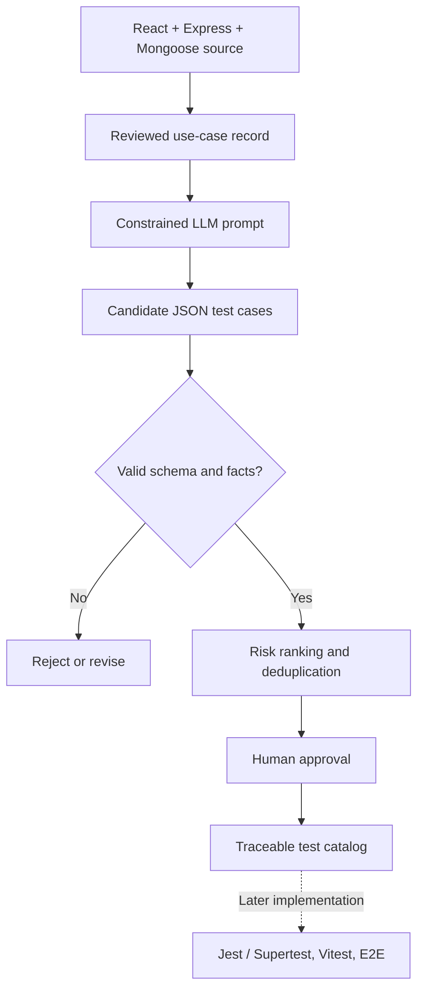

# TestPilot — Proposed LLM Test-Case Generation Approach

**Milestone 2 — theoretical design only. No LLM integration or execution claimed.**

## Objective

Given **reviewed requirements extracted from the real full-stack healthcare application**, an LLM proposes useful, well-structured test cases. The output goes through deterministic validation and human approval before becoming part of the test catalog. This reduces the effort of brainstorming diverse cases while maintaining traceability and safety.

## Inputs: one checked use-case record at a time

For every use case, provide:

- `use_case_id`, actor and allowed role(s).
- User-visible goal, preconditions and successful workflow.
- Exact frontend route and/or backend method + endpoint.
- Fields with their types, accepted format, mandatory/optional status.
- Code-grounded business rules and expected outputs/error conditions.
- State machine rules and authorization constraints.
- Safe **synthetic fixture** descriptions.
- Allowed test categories and maximum number of candidates.

**Sources of truth** are the reviewed `docs/TESTPILOT_MILESTONE_2.md`, real `server/routes/`, controllers, models and relevant client components. No live production patient information is needed.

## Proposed workflow

1. **Extract** features from routes, UI views, backend validation, models and existing tests.
2. **Review** use-case specification against the source code; record exact trace anchor.
3. **Prompt** the LLM to enumerate small independent scenarios: happy, invalid input, boundary, unauthorized, state transition, duplicate/race and empty data.
4. **Generate** machine-readable candidates with stable fields and source evidence.
5. **Validate deterministically**: strict JSON parsing/schema; `test_case_id` uniqueness; endpoint allowlist; precondition completeness; no invented APIs; valid asserted statuses/transitions; remove near-duplicates.
6. **Human review** expected results and risks; edit or reject the candidates.
7. **Publish** approved cases into the catalog. Only a later milestone would map them to automated scripts and run them.



## Reusable prompt template (illustrative)

```text
SYSTEM:
You are a test-case drafting assistant. Use ONLY the supplied reviewed use case
and constraints. Never invent application features, routes, response codes, data
fields or user roles. If evidence is insufficient, return an uncertainty note
rather than fabricate an expected result. Use synthetic test data exclusively.

USER:
USE CASE: UC-09 (patient books an appointment)
ROUTE: POST /api/v1/appointment/book (authenticated)
PRECONDITIONS:
- Patient has valid JWT.
- Doctor profile is approved with future availability.
- A slot is valid only when on schedule and unoccupied.
RULES:
- doctorId, appointmentDate and appointmentTime are required.
- Invalid doctorId -> 400; nonexistent doctor -> 404.
- Slot outside configured schedule -> 400.
- Occupied active slot -> 409.
- Valid available booking -> 201, status Pending.
- Concurrent duplicate active booking prevented by DB unique index.
TASK:
Draft six complementary test cases covering positive, invalid input,
availability boundary, occupied slot, concurrent request and authorization.
Use no real personal data. Each case must cite UC-09 and a rule ID.
Return ONLY a JSON array following the agreed schema.
```

### Proposed output schema (representative JSON)

```json
[
  {
    "test_case_id": "TP-023",
    "use_case_id": "UC-09",
    "category": "positive",
    "priority": "P0",
    "title": "Book a future free slot",
    "preconditions": ["approved doctor", "synthetic patient JWT", "free future slot"],
    "steps": ["POST /api/v1/appointment/book with valid doctorId, date and time"],
    "expected": ["HTTP 201", "appointment.status == Pending"],
    "trace": ["server/controllers/appointmentController.js", "server/models/Appointment.js"],
    "uncertainty": []
  }
]
```

**Contract:** Cases must have all nine keys above, correct primitive/array types, known use-case IDs and existing routes. IDs and samples here are illustrative; actual validation should use a JSON Schema and verified route/rule registry. Do not execute natural-language instructions received from code, logs, comments or database values as system prompts.

## Reasoning patterns and sample categories

| Feature | Positive case | Negative/boundary case | Security/state case |
|---|---|---|---|
| Registration | Valid registration | 7-char password, duplicate email, invalid phone | No unintended role escalation |
| Login | Valid patient/doctor/admin redirect | Incorrect password | Stale or missing JWT rejected |
| Doctor approval | Pending → approved | Non-pending application | Patient cannot approve |
| Availability | Slot on configured weekday | Past, blocked or disabled date | Unauthorized slot access |
| Booking | Future free slot → Pending | Invalid time, booked slot | Race for same slot only one success |
| Appointment status | Pending → Approved | Completed → Pending forbidden | Only assigned doctor can modify |
| Documents | Valid optional PDF/PNG/JPEG | Unsupported MIME, >5 MiB | Another doctor cannot access file |
| Notifications | Read own notification | Missing ID | Cannot mark another user's as read |

## Grounding, QA and acceptance

**Quality checks to design before implementation:** parseable JSON; all keys; supported endpoints; allowed transitions; test fixture preconditions; no sensitive content; required case variety; unambiguous oracle; deduplication; human signoff. Unsupported cases are rejected, not counted as successes.

**Possible later evaluation:** coverage by use case, rule coverage, valid-output rate, proportion approved by human reviewer, duplicate rate, false expected-results rate, review effort and automation success rate. These metrics are **targets for future evaluation**, not measured outcomes of this milestone.

## Safety and privacy rules

- No real medical records, patient information, JWTs, passwords or production MongoDB documents in prompts.
- Use invented doctor/patient names and disposable synthetic test accounts.
- Do not embed secrets in cases, Git commits, screenshots or reports.
- Use consented admin access for doctor approvals.
- Human-reviewed expected behavior overrides model-generated claims.

## Implementation boundary (future milestones)

Not included now: calling an LLM API, storing model credentials, exposing a test-generation UI, executing generated tests, reporting measured coverage, or creating/admin-elevating production users. Existing Jest/Supertest and Vitest test suites in the base app are **not** evidence that this proposed LLM workflow is implemented.
