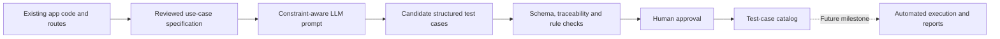

# TestPilot — Milestone 2: Use Cases and LLM-Assisted Test Design

**Status:** Design/documentation completed; LLM generation is a **proposal, not an implemented feature**.  
**Reviewed against:** React routes, Express API routes/controllers, Mongoose models and existing tests in this repository.  
**Date:** 14 October 2026.  
**Live frontend:** https://doctor-appointment-frontend-9dbs.onrender.com/  
**Backend health endpoint:** https://doctor-appointment-booking-system-u1eq.onrender.com/

## 1. Project definition and scope

**TestPilot** is a proposed AI-assisted test-case generation workflow **for** an existing doctor appointment booking application. The existing application is the *system under test (SUT)*; TestPilot is the name of the academic test-design project and its customized demo branding. Deploying/rebranding the SUT is complete. For this milestone we document its actual behavior and describe how an LLM *could* suggest tests; we do not claim an LLM is already integrated, that generated tests run automatically, or that the live workflows have all passed.

Architecture: **React + Vite + Bootstrap** (client) → **Axios** using `VITE_API_BASE_URL` → **Express + Node.js** API at `/api/v1` → **Mongoose + MongoDB Atlas**. Authentication uses **JWT**. Backend code supports patients, approved doctors, and admin users.

## 2. Actors and main use cases

| ID | Actor | Actual use case | Main success path | Conditions / failures to test |
|---|---|---|---|---|
| UC-01 | Visitor | Register patient | Name, email, phone, password → account and token → dashboard | Required values; email format/duplicate; 8–128 character password; Indian mobile format |
| UC-02 | Visitor | Log in | Correct credentials → JWT → role-based dashboard | Wrong credentials, missing input, expired/missing token |
| UC-03 | Authenticated user | View session/profile, logout | Profile/session read; logout clears client session | No token; wrong role; stale session |
| UC-04 | Visitor/patient | Discover doctors | `GET /doctor/all` returns approved doctors; details via `GET /doctor/:id` | Empty approved list; pending/rejected doctors hidden; invalid ID |
| UC-05 | Patient | Apply/reapply as doctor | `POST /doctor/apply` creates pending application | Bad contact data, invalid availability, duplicate pending application, approved account cannot reapply |
| UC-06 | Admin | Review doctor applications | List pending; approve/reject; approval sets `isDoctor` | Patient forbidden; invalid ID; invalid state transition |
| UC-07 | Doctor | Manage doctor profile & schedule | Change profile, weekly sessions, durations and blocked dates | Invalid/overlapping sessions; bad fee; unsupported duration; nonapproved doctor forbidden |
| UC-08 | Patient | Find available time slots | Select approved doctor and future date; API generates free slots | Past date; disabled day; blocked date; occupied slot |
| UC-09 | Patient | Book appointment | Select doctor/date/time; optional medical file; create **Pending** appointment | Missing input, invalid ID, slot outside schedule, concurrent double-booking |
| UC-10 | Patient | View appointments | `GET /appointment/user` returns own appointments and statuses | Access without token; cross-user isolation |
| UC-11 | Doctor | Review appointments | `GET /appointment/doctor` returns assigned appointments | Other doctor's appointments not visible |
| UC-12 | Doctor | Change appointment status | **Pending → Approved/Rejected**, **Approved → Completed** | Illegal changes rejected; Rejected/Completed terminal |
| UC-13 | Doctor | Access attached medical file | Authenticated assigned doctor downloads own appointment attachment | Unsupported file/over 5 MB; cross-doctor access; missing file |
| UC-14 | Authenticated user | Notifications | List own, unread count, mark one/all read, delete one/all | Another user's notification inaccessible; empty list |
| UC-15 | Any actor | Role-based navigation | Patient/doctor/admin dashboard routes and API authorizations | Unauthorized or incorrect role must be denied |

**Important distinction:** The public homepage fetches approved doctors. An empty `doctors` array displays **“No approved doctors found”**, which is a valid empty-data state and **does not by itself prove an API failure**. Booking demonstration requires an *approved* doctor record with future availability.

## 3. Important business rules verified in code

- New patient registration validates name length (2–100), email, password length (8–128) and Indian mobile phone format `[6-9][0-9]{9}`; duplicate email is rejected.
- The doctor discovery API returns **only** `status: "approved"` profiles.
- A doctor's permitted slot durations are **15, 20, 30, 45 or 60 minutes**. Weekly availability and blocked dates determine possible slots.
- A past appointment date is invalid; a disabled/blocked day can return zero available slots.
- A successful booking creates an appointment with initial status **Pending**. A unique partial MongoDB index prevents more than one **Pending/Approved** appointment for the same doctor/date/time, even under concurrent requests.
- Only allowed appointment transitions are **Pending → Approved or Rejected**, then **Approved → Completed**. Rejected and Completed are terminal.
- Optional uploads accept **PDF, JPEG, PNG** (maximum **5 MiB**); assigned-doctor authorization guards document retrieval.
- API role checks are enforced on the server; frontend route protection provides an additional navigation guard.
- Notifications are associated with the current user. Notification errors do not intentionally undo a successfully saved booking/status change.

Code trace anchors: `client/src/App.jsx`, `client/src/components/ProtectedRoute.jsx`, `client/src/components/FeaturedDoctors.jsx`, `client/src/services/api.js`; `server/routes/*.js`; `server/controllers/{auth,doctor,appointment,admin,notification}Controller.js`; `server/models/{User,Doctor,Appointment}.js`; `server/middleware/medicalDocumentUpload.js`.

## 4. A representative end-to-end scenario (planned demonstration)

1. Open the hosted frontend, register a **synthetic** patient, then log in.
2. Log in to an **authorized test admin account** and check pending doctor applications.
3. From a separate synthetic patient account, submit a doctor application; admin approves it. If no authorized admin account exists, this is a *setup blocker*, not a UI bug; do not elevate users or edit production data without approval.
4. Configure the approved doctor's availability for a future date.
5. Log in as patient, find that doctor, choose a free slot, and book the appointment.
6. Confirm the new **Pending** booking under **My Appointments**.
7. Log in as the approved doctor, **Approve** the booking and confirm the patient's updated status/notification.
8. Optionally demonstrate **Completed** status and an authorized medical file download with **synthetic, non-medical test content only**.

**Current evidence boundary:** Repository code was inspected and Render reported a live deployment. A screenshot showed an empty approved-doctor list. This report does **not** claim the scenario above has been executed on production.

## 5. Proposed test-case generation with an LLM (theoretical)

**Input:** A reviewed use-case record with actor, preconditions, fields, constraints, valid transitions, endpoint or page, and expected outcomes.  
**Generation:** Prompt an LLM to propose positive, negative, boundary, authorization, state-transition and concurrency scenarios, **only from supplied facts**.  
**Validation:** Enforce JSON schema, unique IDs, required keys, source/use-case traceability and feasible preconditions; compare assertions against code-backed rules; flag unsupported claims.  
**Human review:** Tester examines output, removes irrelevant cases, confirms expected results, prioritizes by risk.  
**Output:** Approved, traceable test-case descriptions (not automatically executed in this milestone).  
**Future work:** Export selected approved cases into Vitest / React Testing Library, Jest / Supertest, or browser E2E tests; add execution reporting and feedback loop.

The proposed LLM helps **draft** test cases; assertions and ground truth still come from specifications, code and approved fixtures, not from LLM confidence.

## 6. Reproducibility, privacy and evaluation

Use synthetic accounts and non-sensitive sample files. **Never send JWTs, passwords, real patient names, production database dumps or real medical documents into LLM prompts.** Share only minimal, redacted or synthetic requirements. Maintain a fixture inventory with role and schedule setup; reset test data between runs.

Suggested *future* evaluation metrics (targets, **not achieved results**): valid structured-output rate ≥95%; every accepted test traces to one use case and one actual rule; coverage of positive/negative/boundary paths for high-risk use cases; reviewer rejection rate; duplicates removed; zero sensitive data in prompts. Human-approved oracle accuracy is more important than raw case count.

### Potential risks and mitigations

| Risk | Mitigation |
|---|---|
| Hallucinated endpoints or behaviors | Give exact code-derived route list; reject any unsupported endpoint |
| Incorrect expected results | Human verifies against controller/model; keep trace references |
| Leaking patient information | Synthetic fixtures, redaction, no uploads of real medical records to LLM |
| Duplicate or impossible cases | Normalize IDs, required preconditions, deduplicate |
| Changes to SUT over time | Review case library each time routes/models change |
| Misrepresenting project progress | Label **proposed**, **illustrative**, **code reviewed**, and **executed** separately |

## 7. Milestone status

| Work item | Status and evidence |
|---|---|
| Existing healthcare app selected and deployed | Complete; frontend/backend hosted on Render |
| GitHub, backend and MongoDB connection setup | Complete as previously configured; code and Render service reviewed |
| Current app architecture, actors and use cases documented | **Complete in this repository** |
| Traceable illustrative test-case matrix | **Complete**: see [TEST_CASE_MATRIX.md](TEST_CASE_MATRIX.md) |
| Theoretical LLM generation workflow and prompt contract | **Complete**: see [LLM_TEST_CASE_DESIGN.md](LLM_TEST_CASE_DESIGN.md) |
| LLM model integrated with application | **Not started / not required for this milestone** |
| Generated tests executed by an LLM-based engine | **Not done** |
| Production booking end-to-end verified with test doctor | **Not verified; approved doctor test fixture needed** |

## 8. Submission / review links

- [Test-case catalog](TEST_CASE_MATRIX.md)
- [LLM generation approach and example prompt](LLM_TEST_CASE_DESIGN.md)
- [Existing repository README](../README.md)
- [Deployed TestPilot frontend](https://doctor-appointment-frontend-9dbs.onrender.com/)
